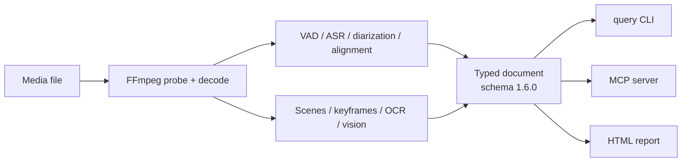

<div align="center">

# SONOLYTICA

**Media becomes a document an agent can cite.**

Local, typed, timestamped. Speech with word timings and speaker turns, shots and
keyframes, on-screen text, faces, objects, pose, captions and music — one
timeline, provenance on every fact, no cloud.

**v0.2.2** — stable local release; models are opt-in, digest-pinned and never
uploaded. macOS arm64, Linux x86_64/arm64, and Windows 10/11 x64.

[](https://github.com/neksand/sonolytica/actions/workflows/ci.yml)
[](https://github.com/neksand/sonolytica/releases)
[](#license)
[](#development)
[](docs/MODELS.md)
[](docs/SCHEMA.md)
[](docs/MCP.md)
[](docs/DOCKER.md)
[](#platforms)

</div>

```console
$ sonolytica analyze meeting.mp4 --out meeting.json --ocr --caption --summary
$ sonolytica query brief meeting.json
$ sonolytica query search meeting.json pricing
00:00:43.608–00:00:47.608  speech         S2  The pricing page goes live on Friday!  [0.680]
                                              pricing 00:00:44.058–00:00:44.928
$ sonolytica query ask meeting.json "did anyone mention a budget cut?" --json
{"terms":["mention","budget","cut"], "absence":[{"term":"cut","occurrences":0}], ...}
```

Agents answer from `meeting.json` with exact quotes and ranges, or say the fact
is absent. They never guess, and every claim is checkable.

## Why SONOLYTICA

Text-only agents are blind without a document. A shell can run `ffmpeg` and
`whisper`; it cannot tell you **who** spoke at 02:14, what was on screen at
01:20, or whether a budget cut was ever mentioned. SONOLYTICA builds that
document once, locally, and answers from it.

- **Citations, not vibes.** Every range is a document fact. Missing data is
  `null`, a warning or `partial` — never a plausible sentence.
- **Local and private.** No API, no upload, no per-minute bill. Whisper,
  Silero, Sortformer, PP-OCRv5, YuNet, YOLOS, MoveNet and Florence-2 run on your
  machine, pinned by SHA-256.
- **Built for agents.** A typed JSON schema, 17 query subcommands, a 200-line
  skill, and an MCP server for clients that cannot run a shell.
- **Built for humans too.** One self-contained HTML report with chapters,
  quotes, keyframes, OCR, faces, objects, pose and captions.

## What is in the document

| Layer | Facts | Provider |
|---|---|---|
| Speech | words, ranges, confidence, language | Whisper (whisper.cpp) |
| Speakers | turns, overlap spans, speaking time | Sortformer 4spk v2.1 (AOSC), pyannote fallback |
| Alignment | word boundaries, ~110 ms median drift | wav2vec2 CTC (English) |
| Video | shots, cuts, keyframes, dense frames | FFmpeg signatures (2 fps) |
| On-screen text | exact OCR lines with boxes | PP-OCRv5 |
| Faces | count and boxes per keyframe, never identity | YuNet (opt-in `--faces`) |
| Objects | 91 COCO classes, boxes and scores | YOLOS-tiny (opt-in `--objects`) |
| Pose | 17 COCO body keypoints per person per keyframe | MoveNet Multipose (opt-in `--pose`) |
| Captions | model-generated description of each keyframe | Florence-2-base-ft (opt-in `--caption`) |
| Music | tempo, key, triads, sections, loudness — gated by evidence | local DSP |
| Acoustics | silence, LRA, true peak | local DSP |

Every fact carries a `run`: provider, model digest, license, status and device.
The document passes `Document::validate` before it is written. Missing facts are
`null`; a failed stage is a warning or `partial`, never silent.

Music is evidence-gated: `bpm`, `key`, `chords`, `beats` and `sections` are
`null`/empty on speech or silence, while loudness remains measured. Query JSON
carries `music.present`; do not report a BPM from a document where it is false.

## How it works



The pipeline is staged and failure-isolated: a missing model disables one
capability, never the whole run. Core crates never depend on ONNX Runtime or
whisper.cpp, so the model-free build and test suite work anywhere.

## Install

```bash
# Windows 10/11 x64 (PowerShell 5.1+)
irm https://raw.githubusercontent.com/neksand/sonolytica/main/install.ps1 | iex

# macOS (arm64) / Linux (x86_64/arm64) release binary
curl -fsSL https://raw.githubusercontent.com/neksand/sonolytica/main/install.sh | sh

# or build from source
cargo build --release -p sonolytica-cli --features full-metal   # macOS, Metal
cargo build --release -p sonolytica-cli --features full         # CPU only
```

Requirements: FFmpeg 7+ on `PATH`; `cmake` when building the speech pipeline.
On Windows: `winget install Gyan.FFmpeg` (or `choco install ffmpeg`), then a
new terminal. Models are downloaded on demand and verified by digest.

```bash
sonolytica setup                  # doctor, core models (~1.5 GB), agent skill
sonolytica setup --full           # + OCR, faces, objects, pose, Florence captions
sonolytica doctor                 # what this machine can actually run
sonolytica completions bash       # or zsh / fish / powershell
```

## Platforms

| Platform | Support | Artifact |
|---|---|---|
| **Windows 11 x64** | supported | `sonolytica-x86_64-pc-windows-msvc.zip` |
| **Windows 10 x64** (22H2) | supported | the **same** Windows zip |
| Windows 8 / 8.1 | not supported | — |
| Windows on ARM, 32-bit Windows | not supported | — |
| macOS 14+ arm64 | supported | `sonolytica-aarch64-apple-darwin.tar.gz` |
| Linux x86_64 | supported | `sonolytica-x86_64-unknown-linux-gnu.tar.gz` |
| Linux arm64 | supported | `sonolytica-aarch64-unknown-linux-gnu.tar.gz` |

Windows 10 and 11 share the same x64 Win32 ABI, so there is **one** binary, not
two byte-identical downloads. It is built and tested on GitHub's Windows
runners and uses the native MSVC toolchain. Windows 8/8.1 is end-of-life and is
not supported by the current Rust/MSVC, ONNX Runtime and FFmpeg toolchains; no
separate legacy build is shipped. Details and manual install:
[`docs/WINDOWS.md`](docs/WINDOWS.md).

`setup` is idempotent: existing models are verified and skipped, and the skill
is installed into Claude Code, Codex, OpenCode and Cursor. Use `--no-models` or
`--no-skill` to skip a part. `install-skill` is also a standalone command with
`--project`, `--dry-run` and `--uninstall`.

## Quick start

```bash
sonolytica analyze talk.mp4 --out talk.json --profile standard --ocr --caption --summary

sonolytica query brief talk.json            # media, runs, speakers, chapters, cuts, OCR
sonolytica query search talk.json budget    # exact ranges, never rounded
sonolytica query ask talk.json "did anyone mention a deadline?" --json
sonolytica query timeline talk.json --from 00:01:20 --to 00:01:30
sonolytica query speakers talk.json
sonolytica query captions talk.json --json
sonolytica query poses talk.json --json
sonolytica query verify talk.json --claims answer.json  # quote + range check

sonolytica report talk.json --out talk.html # one self-contained human page
```

`report` writes one HTML file plus its keyframes — open it, share it, print it.
Every quote carries its range; warnings are shown, not hidden. One-file demo:
`scripts/demo.sh talk.mp4`.

## Use it from an MCP client

Shell-less clients (Claude Desktop, Cursor, IDE agents) use the stdio server:

```json
{
  "mcpServers": {
    "sonolytica": {
      "command": "sonolytica",
      "args": ["mcp"]
    }
  }
}
```

The server exposes 14 tools: `analyze_media`, `query_brief`, `query_ask`,
`query_timeline`, `query_search`, `query_transcript`, `query_words`,
`query_speakers`, `query_captions`, `query_poses`, `query_runs`,
`query_verify`, `list_models`, `doctor`. Every call runs the same local binary
and cache; there is no cloud and no second query implementation. Full setup,
tool arguments and limits: [`docs/MCP.md`](docs/MCP.md).

## Docker

```bash
docker build -t sonolytica .
docker volume create sonolytica-data
docker run --rm -v sonolytica-data:/data sonolytica setup --no-skill

docker run --rm \
  -v sonolytica-data:/data \
  -v "$PWD:/media" \
  sonolytica analyze /media/talk.mp4 --out /media/talk.json --ocr --caption --summary
```

The image is 790 MB, carries the CLI and FFmpeg 7, and keeps models/cache in a
`/data` volume. Verified on arm64: `doctor`, `analyze` with mounted models,
`query brief` and MCP. Build/run/compose and MCP-from-container:
[`docs/DOCKER.md`](docs/DOCKER.md).

## Command reference

### `analyze`

| Flag | What it does |
|---|---|
| `--profile structure\|standard\|ultra` | structure (no transcript) / everything / everything + align + strict |
| `--modules vad,transcribe,diarize,...` | explicit stage list |
| `--language xx` | preferred language; pass it whenever you know it |
| `--model <id>` | explicit ASR model; default: English `whisper-base.en`, non-English prefers `whisper-small`, `auto` follows that policy |
| `--align` | wav2vec2 forced word alignment (English) |
| `--ocr` | PP-OCRv5 on keyframes |
| `--faces` | YuNet face boxes, no identity |
| `--objects` | YOLOS-tiny 91 COCO classes |
| `--pose` | MoveNet 17 COCO body keypoints |
| `--caption` | Florence-2 keyframe description |
| `--frame-stride N` | dense keyframes every N seconds |
| `--max-frames N` | cap keyframe count |
| `--no-frames` | no images next to the document |
| `--summary` | human summary on stderr |
| `--strict` | exit 2 if a requested stage failed |
| `--no-cache` / `--cache-dir` | bypass or relocate the analysis cache |

### `query`

| Command | Output |
|---|---|
| `brief` | compact map: media, runs, speech, speakers, chapters, counts |
| `ask` | deterministic evidence pack for a question + absent terms |
| `timeline` | segments in a window, optional `--type` |
| `at` | what is active at one instant |
| `search` | case-insensitive matches with ranges, speakers and words |
| `transcript` | full transcript, untruncated |
| `words` | every word of one speech segment |
| `speakers` | speaking time per speaker, longest first |
| `chapters` | structural boundaries: silence, speaker change, scene cut |
| `frames` | keyframe images and their instants |
| `captions` | model-generated keyframe descriptions |
| `poses` | body keypoints per person per keyframe |
| `music` | tempo, key, chords, loudness |
| `acoustic` | silence and level summary |
| `runs` | stage status, provider and warnings |
| `summary` | media facts, counts, analyses, warnings |
| `verify` | mechanical quote + range verification; exit 1 on a failed claim |

Every query accepts `--json`. `query` never loads a model and never mutates the
document.

### Top-level commands

| Command | Purpose |
|---|---|
| `setup` | one-command onboarding: models + skill |
| `mcp` | MCP stdio server for shell-less clients |
| `report` | self-contained HTML + copied keyframes |
| `install-skill` | embed/install the agent skill (4 harnesses) |
| `models list\|fetch` | pinned models, license, local verification |
| `cache` | inspect or clear the analysis cache |
| `completions` | bash/zsh/fish completion |
| `doctor` | FFmpeg, providers, build check |
| `inspect` | container/stream metadata |
| `schema` | schema example |

## Document schema 1.6.0

One media file → one JSON document. Timeline in integer **microseconds**;
ranges are half-open. Segment kinds: `speech`, `speaker_turn`, `music_label`,
`acoustic_event`, `scene`, `object`, `pose`, `caption`, `text_overlay`.
Tracks: speech, speaker turns, music, acoustic, scene, object, face, pose,
caption, text.

```jsonc
{
  "id": 247,
  "track": 1,
  "range": { "start": 43608000, "end": 47608000 },
  "kind": {
    "type": "speaker_turn",
    "speaker": "S2",
    "text": "The pricing page goes live on Friday!",
    "overlap": false
  },
  "confidence": 0.68,
  "run": 2
}
```

Every segment points at a `RunRecord` (provider, model digest, license, status,
duration). The validator checks ids, references, hierarchy, confidence ranges,
media bounds and pose coordinates. Full description:
[`docs/SCHEMA.md`](docs/SCHEMA.md).

## Models

14 models, all SHA-256 pinned, downloaded on demand, never vendored.

| Group | Models | License |
|---|---|---|
| Speech | Silero VAD v5; whisper tiny.en / base.en / small; wav2vec2-base-960h | MIT / MIT / Apache-2.0 |
| Diarization | Sortformer 4spk v2.1 (AOSC); pyannote segmentation-3.0; WeSpeaker CAM++ | NVIDIA Open Model License / MIT / Apache-2.0 |
| OCR | PP-OCRv5 det + rec | Apache-2.0 |
| Vision | YuNet face detection; YOLOS-tiny objects; MoveNet Multipose pose; Florence-2-base-ft captions | MIT / Apache-2.0 / Apache-2.0 / MIT |

`sonolytica models list` shows size, license and verification. A digest
mismatch is refused, never loaded. Licenses, sources and redistribution notes:
[`docs/MODELS.md`](docs/MODELS.md), attribution in [`NOTICE`](NOTICE).

## Measured, not claimed

Full method, failures and raw outputs: [`docs/BENCHMARK.md`](docs/BENCHMARK.md),
[`docs/EVAL.md`](docs/EVAL.md), [`docs/STATUS.md`](docs/STATUS.md).

### Agent benchmark

Same fixtures, same prompts, 0/2 per task. DeepSeek V4.1 Flash + the skill,
clean directories; medians with ranges.

| Fixture | Score | Fresh tokens (median) |
|---|---|---|
| easy 14.4 s, 4 questions | **8/8** | **8 818** (7 517–21 021, n=5) |
| hard 4 min, 8 questions | **16/16** | **14 773** (13 517–27 235, n=3) |
| long 20 min, 8 questions | **14/16\*** | **13 443** (11 308–15 578, n=2) |

`*` Q4 corrected: the `fvhrk` RTTM has only `spk02` at 19:15–19:32; the old
"overlap" spans were merge artifacts. The old paid long runs rescore 14/16 /
13/16; the AOSC free run is 16/16. See [`docs/bench/overlap.md`](docs/bench/overlap.md).

Free-model runs, clean directories, **$0**:

| Fixture | DeepSeek free | GLM free |
|---|---|---|
| easy | **8/8 / 18 224** | **8/8 / 24 294** |
| hard | **16/16 / 19 396** | **16/16 / 23 025** |
| long | **16/16\* / 31 570** | — |
| visual boundary | **16/16 refusal / 17 652** | **16/16 refusal / 24 130** |
| visual + caption | **16/16 / 31 961** | **16/16 / 25 832** |

### Head-to-head

Same hard fixture, same questions:

| System | Score | Citations in the blind judge |
|---|---|---|
| SONOLYTICA + DeepSeek | **16/16** (blind 15/16) | **19 valid** |
| Gemini + skill | **16/16** | 19 |
| Gemini alone | 14/16 (blind 10/16) | 7 |
| TwelveLabs Pegasus 1.5 | 10/16 (blind 7/16) | 3 |

On the long 20-minute meeting: SONOLYTICA **16/16\***, Gemini + skill **14/16\***,
TwelveLabs **10/16**. The design trade is explicit: citations, locality and
cost first; free-form visual semantics are on the roadmap.

### Performance

| Metric | Value |
|---|---|
| 20-minute meeting, full audio pipeline | **45.1 s** (26× realtime), 2.07 GB peak RSS |
| Analysis cache hit | **0.01 s** vs 7.64 s first run (14.4 s fixture) |
| Diarization `fvhrk` | **4/4 speakers**, DER **6.40 %**, JER **6.29 %** (was 2/4, 15.99 %) |
| ASR | WER **6.05 %**, CER **2.25 %** (LibriSpeech test-clean, 100 utts) |
| OCR | 12/12 lines on the 6-slide fixture; 7/7 CJK terminal |
| Docker image | **790 MB**, FFmpeg 7.1.5, verified end-to-end |

## How it compares

| | Gemini / TwelveLabs | WhisperX + pyannote scripts | **SONOLYTICA** |
|---|---|---|---|
| Runs locally, no upload | no | yes | **yes** |
| Word-level quotes with ranges | summary-level | yes | **yes, validator-enforced** |
| Speaker turns + overlap map | partial | yes | **yes** |
| On-screen text + shots + keyframes | partial | no | **yes** |
| Faces / objects / pose / captions | via model | no | **yes, opt-in, keyframe-bound** |
| Typed schema for agents | no | no | **yes (1.6.0)** |
| Agent interface | prompt / API | shell + glue | **CLI + 17 queries + MCP** |
| Human report | partial | no | **one HTML file + keyframes** |
| Cost | $/hour of video | free + glue | **free after models** |
| Open-ended visual semantics | **strong** | no | captions + detectors; free-form VQA planned |

The thesis: for **structured media questions** — who said what, when exactly,
what was on screen, was X ever mentioned — a citable local document beats a
raw multimodal prompt. For **"what is happening in this picture"**, use a
vision model; SONOLYTICA's captions are a bridge, not a replacement.

## Real use cases

- **Meeting and interview intelligence for agents.** Quotes, speaker turns,
  decisions, action items, absence checks; MCP for Claude Desktop/Cursor.
- **Lecture, webinar and screencast Q&A.** Transcript + slide OCR + chapters +
  keyframes; a study guide with timestamps.
- **Podcast and video edit search.** Find the moment, the speaker, the music
  section, the BPM; export a clip.
- **Legal, compliance and security review.** Exact quotes and ranges, local
  data, no upload; "was X mentioned" is a checked absence.
- **Offline/private deployments.** Hospitals, law firms, newsrooms, field
  teams; Docker with a `/data` volume.
- **Agent/RAG over media.** One document per file, citations, `query verify`;
  no vector database needed for a single recording.

## Privacy and security

Media is untrusted input; the document is the trust boundary. FFmpeg runs as a
subprocess with an argv array and a protocol whitelist, every stage has limits
and timeouts, models are digest-pinned, and documents are validated before
emission. MCP is local stdio only; run it as an unprivileged user. Details:
[`docs/SECURITY.md`](docs/SECURITY.md).

## Roadmap and plans

- **Overlap-aware diarization + speaker-attributed ASR.** The hard 4-minute
  fixture has a real 1.4 s S3/S4 overlap. A Parakeet TDT multitalker pass
  recovers the missing line with a reference mask; the current AOSC mask sees
  S4 at ≤0.011 there. Next: an overlap-aware diarizer (offline v2,
  Nemotron-3-Diarization, or separation) feeding Parakeet. Protocol and gate:
  [`docs/bench/overlap.md`](docs/bench/overlap.md).
- **Free-form visual Q&A** (SmolVLM2-500M, Apache-2.0) on top of the Florence
  caption tier.
- **5+ speakers** with an 8-speaker diarizer; the current 4-slot cap is
  documented and warned.
- **Music notes and stems** (basic-pitch, Demucs) after the structural layer.
- **Non-English word alignment** (MMS/XLSR) for citation-grade timings.
- **Distribution**: brew tap, streamable HTTP MCP, cache eviction, demo video
  and more benchmark fixtures.

Until these land, the document is explicit about the boundary: a four-slot
hypothesis carries `diarization_speaker_cap`, captions are model observations,
and overlapping words may be merged into one ASR stream.

## Development

```bash
cargo test --workspace                 # 184 tests, no models, no cmake, no ONNX runtime
cargo test --workspace --all-features  # 201 tests, every provider compiled in
cargo clippy --workspace --all-targets --all-features -- -D warnings
cargo fmt --all -- --check
```

| Crate | Role |
|---|---|
| `crates/core` | document model, schema, validator, timeline math |
| `crates/engine` | pipeline stages and the async boundary |
| `crates/providers` | model registry, Whisper, Silero, Sortformer, OCR, vision, VLM |
| `crates/cli` | analyze, query, report, MCP, setup, models |
| `crates/dsp` | tempo, key, chroma, loudness, silence |
| `crates/media` | FFmpeg probe/decode, keyframes, hashing |
| `crates/eval` | WER/CER, DER/JER |

Design: [`docs/ARCHITECTURE.md`](docs/ARCHITECTURE.md) and [`docs/adr/`](docs/adr/).
Benchmark protocol: [`docs/BENCHMARK.md`](docs/BENCHMARK.md). Release notes:
[`docs/RELEASE-0.2.2.md`](docs/RELEASE-0.2.2.md) (trust fixes),
[`docs/RELEASE-0.2.1.md`](docs/RELEASE-0.2.1.md) (Windows) and
[`docs/RELEASE-0.2.0.md`](docs/RELEASE-0.2.0.md). Launch brief:
[`docs/LAUNCH.md`](docs/LAUNCH.md).

Contributions are welcome: open an issue with a minimal reproducer, or a PR
with a test that would fail on the current main. No GPL dependencies.

## Topics

<sub>
media-analysis · video-understanding · audio-transcription · speech-to-text ·
speaker-diarization · speaker-identification · voice-activity-detection ·
word-timestamps · forced-alignment · subtitle-generation · meeting-notes ·
interview-transcription · podcast-search · lecture-notes · video-search ·
video-indexing · scene-detection · shot-detection · keyframe-extraction ·
on-screen-text · OCR · screen-recording · screencast · document-intelligence ·
RAG · retrieval-augmented-generation · LLM-agents · AI-agents · agent-tools ·
Model-Context-Protocol · MCP · tool-use · local-ai · offline-ai · privacy ·
edge-ai · on-device · Rust · Rust-CLI · Whisper · whisper.cpp · Silero ·
Sortformer · NVIDIA-Sortformer · pyannote · WeSpeaker · PP-OCRv5 · PaddleOCR ·
YuNet · YOLOS · MoveNet · Florence-2 · VLM · vision-language-model ·
timestamped-transcript · citation · provenance · JSON-schema · SQLite-free ·
no-cloud · self-hosted · Docker · Windows · Windows-10 · Windows-11 · PowerShell
</sub>

<!-- Suggested GitHub repository topics:
media-analysis, video-understanding, audio-transcription, speech-to-text,
speaker-diarization, ocr, rag, llm-agents, mcp, local-ai, rust, whisper,
sortformer, florence-2, offline-ai, privacy, docker, windows, windows-10,
windows-11
-->

## License

Dual-licensed **MIT OR Apache-2.0**. Model artifacts keep their own permissive
licenses (no GPL) and are never vendored; FFmpeg is a subprocess, not a link.
See [`LICENSE-MIT`](LICENSE-MIT), [`LICENSE-APACHE`](LICENSE-APACHE),
[`NOTICE`](NOTICE) and [`docs/MODELS.md`](docs/MODELS.md).
